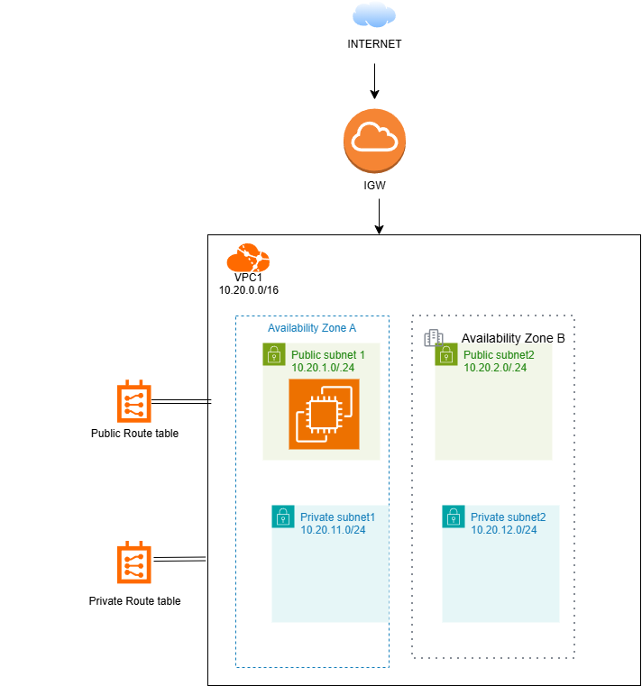

# Week 1 – AWS VPC Networking Project

## Project: Custom VPC Architecture

**VPC Name:** VPC1  
**VPC CIDR:** `10.20.0.0/16`  
**Region:** US East (N. Virginia) – `us-east-1`  
**Project Type:** Cloud Computing Internship – Week 1

## 1. Project Overview

This project demonstrates the creation and configuration of a custom Virtual Private Cloud (VPC) with public and private subnets distributed across two Availability Zones.

The objective is to understand AWS networking fundamentals, subnet segmentation, route tables, Internet Gateway configuration, security groups, and public connectivity.

## 2. Architecture Diagram

## 3. VPC Configuration

| Component | Configuration |

| VPC Name | VPC1 |
| IPv4 CIDR | 10.20.0.0/16 |
| Availability Zones | 2 |
| Total Subnets | 4 |
| Public Subnets | 2 |
| Private Subnets | 2 |
| Internet Gateway | Attached |
| DNS Resolution | Enabled |
| DNS Hostnames | Enabled |
| NAT Gateway | Not configured |

## 4. Subnet Configuration

| Subnet | CIDR Block | Type |

| Public Subnet A | 10.20.1.0/24 | Public |
| Public Subnet B | 10.20.2.0/24 | Public |
| Private Subnet A | 10.20.11.0/24 | Private |
| Private Subnet B | 10.20.12.0/24 | Private |

The subnets are distributed across two Availability Zones for network organization and availability.

## 5. Route Table Configuration

### Public Route Table

| Destination | Target |

| 10.20.0.0/16 | local |
| 0.0.0.0/0 | Internet Gateway |

Associated with both public subnets.

### Private Route Table

| Destination | Target |

| 10.20.0.0/16 | local |

Associated with both private subnets.

Private subnets have no direct Internet Gateway route. NAT Gateway was not configured.

## 6. Internet Gateway

An Internet Gateway was created and attached to VPC1.

The public route table uses the Internet Gateway as its default route to allow internet connectivity for eligible public subnet resources.

## 7. Security Group

**Security Group:** Week1-Test-SG

| Type | Protocol | Port | Source |

| HTTP | TCP | 80 | 0.0.0.0/0 |

No SSH rule is open to the entire internet.

## 8. EC2 Public Connectivity Test

A public EC2 instance was deployed in Public Subnet A.

- Operating System: Amazon Linux 2023
- Web Server: Apache HTTP Server
- Web Server Port: 80

A test webpage was created:

`Week 1 AWS VPC Public Connectivity Test`

**Result:** Successfully accessed the test webpage using the EC2 public IPv4 address through a web browser.

## 9. Verification

The following configurations were checked:

- Custom VPC CIDR
- Four subnet configurations
- Two Availability Zones
- Internet Gateway attachment
- Public route table and subnet associations
- Private route table and subnet associations
- DNS resolution and DNS hostnames
- Security Group inbound rules
- EC2 instance status
- Public HTTP browser connectivity

Note: Private subnet isolation was verified through its route table configuration; a separate private-instance connectivity test was not performed.

## 10. Cost Management and Cleanup

- NAT Gateway was not created.
- Temporary EC2 resources should be stopped or terminated after assessment.
- Unused public IPv4 addresses and other billable resources should be released.
- The VPC and related networking resources should be deleted after assessment if no longer required.

## 11. Skills Learned

- VPC creation and configuration
- IPv4 CIDR planning
- Public and private subnet creation
- Availability Zone distribution
- Internet Gateway configuration
- Route table configuration
- Security Group management
- EC2 deployment
- Apache web server setup
- Public connectivity troubleshooting

## 12. Conclusion

Successfully created and configured a custom VPC with two public subnets and two private subnets across two Availability Zones.

Verified the public network path and successfully accessed a test webpage hosted on an EC2 instance.

This project provided practical experience with cloud networking and AWS infrastructure fundamentals.
